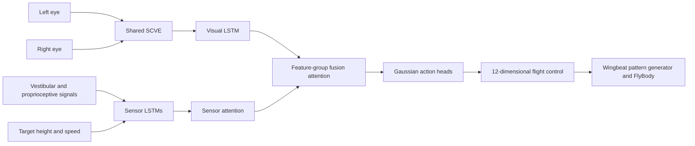

# ImitFly

**Bio-Inspired Sensorimotor Priors Enable Sample-Efficient Cross-Embodiment Control**

Ao Wang, Ziyu Liu, Yingjie He, Xiaopeng Sha, and Shuyu Wang

[中文说明](README.zh-CN.md) · [Data format](docs/DATA_FORMAT.md) · [Experiments](docs/EXPERIMENTS.md)

ImitFly is a bio-inspired sensorimotor architecture for sample-efficient imitation learning.
It combines a **Spiking Convolutional Vision Encoder (SCVE)**, **recurrent sensory encoding**,
and a **Hierarchical Multimodal Attention Mechanism (HMAM)**. A Gaussian policy is trained
by matching expert action distributions with KL divergence.

This repository contains the fruit-fly flight implementation based on the `model_meansnn51`
model family, the FlyBody walking adaptation, and supporting experiment entry points.
Model checkpoints and demonstration datasets are supplied separately.
The monocular quadrotor codebase is outside the scope of this release.

## Architecture



The flight policy consumes five consecutive binocular observations and seven sensor streams.
The shared SCVE produces visual features, parallel LSTMs encode temporal context, and HMAM
combines sensor-level weighting with feature-group attention. Two output heads predict the
mean and log standard deviation of a 12-dimensional diagonal Gaussian. Rollouts use its mean.

## Installation

Python 3.10 is recommended. Create an environment, then install from this directory:

```bash
python -m venv .venv
source .venv/bin/activate
pip install -e '.[sim]'
```

For the reference dependency versions, use:

```bash
pip install -r requirements.txt
pip install -e . --no-deps
```

A Conda environment file is also provided as `environment.yml`.
Use an appropriate PyTorch CUDA wheel if GPU execution is desired.
Student training and evaluation do not require TensorFlow or Acme.

The FlyBody Python source and model meshes needed by the tasks are included in `flybody/`.
Avoid installing a second FlyBody checkout in the same environment.

## Data and pretrained models

Download or obtain the demonstrations and weights separately, then place them in `data/`
and `checkpoints/`, respectively. The repository intentionally contains neither.
See [data documentation](docs/DATA_FORMAT.md) and [checkpoint instructions](checkpoints/README.md).

Flight simulation additionally requires `wing_pattern_fmech.npy`, the baseline wingbeat
pattern used by FlyBody. Walking experiments require the FlyBody walking reference HDF5
file. These assets are external inputs; their paths are supplied explicitly on the command line.
The upstream project is [TuragaLab/FlyBody](https://github.com/TuragaLab/flybody).

## Train ImitFly

The paper-oriented preset uses twelve demonstrations:

```bash
python -m imitfly.cli.train \
  --config configs/imitfly_12_demos.json \
  --data data/flight \
  --output outputs/imitfly_12_demos
```

Each demonstration is stored as an episode NPZ file. Specify training and optional validation
episodes in the configuration. The source-run preset `configs/imitfly_v51.json` retains the
18-episode, 260-epoch settings of the original v51 training script.
The twelve-demonstration preset is provided as a convenient training configuration;
select the final epoch count for the experiment being reproduced.

The trainer saves `latest.pt`, a previous checkpoint, configuration, and a JSONL loss history.
A checkpoint contains the model, optimizer, completed epoch, and random generator states.
Resume at an epoch boundary with the same configuration and data:

```bash
python -m imitfly.cli.train \
  --config configs/imitfly_12_demos.json \
  --data data/flight \
  --output outputs/imitfly_12_demos \
  --resume outputs/imitfly_12_demos/latest.pt
```

## Run a flight policy

For headless rendering, select a supported MuJoCo backend before starting Python:

```bash
export MUJOCO_GL=egl
python -m imitfly.cli.evaluate \
  --checkpoint checkpoints/imitfly_v51.pth \
  --wpg data/assets/wing_pattern_fmech.npy \
  --output outputs/flight_demo \
  --seeds 0 1 2 \
  --video
```

The rollout writes trajectories, requested and clipped actions, a summary, and optional videos.
The normal flight horizon is 0.4 seconds, with a 0.2 ms control interval.
A 30 fps video plays the high-frequency simulation in slow motion.

## Collect expert demonstrations

The expert is a TensorFlow SavedModel returning an action distribution.
Use a **separate Python 3.10 environment** for the historical teacher dependencies:

```bash
pip install -r requirements-teacher.txt
pip install -e . --no-deps
export MUJOCO_GL=egl
python -m imitfly.cli.collect \
  --expert /path/to/vision-trench \
  --wpg /path/to/wing_pattern_fmech.npy \
  --output data/flight \
  --episodes 12
```

The collector records observations and expert means/standard deviations at the same control step.
Existing text-log datasets can be migrated with `python -m imitfly.cli.convert_data`.
See [data documentation](docs/DATA_FORMAT.md) for an example.

## Ablations and walking

Configuration files are provided for SCVE, HMAM, LSTM, and KL-objective ablations,
and for the original CNN-based comparison models. Sensory masking is available during
rollouts with `--mask vision`, `--mask vestibular`, or `--mask proprioception`.
Walking uses a sensor-recurrent attention policy with 59 actions.
See [experiment instructions](docs/EXPERIMENTS.md) for commands and definitions.

## Repository structure

```text
ImitFly/
├── imitfly/
│   ├── models/              # SCVE, HMAM, flight/walking policies and comparators
│   ├── cli/                 # Collection, conversion, training and evaluation
│   ├── data.py              # Episode datasets and legacy conversion
│   ├── losses.py            # Gaussian KL and NLL objectives
│   ├── env.py               # FlyBody task and canonical action interfaces
│   └── checkpoints.py       # Checkpoint loading and saving
├── flybody/                 # Selected FlyBody tasks, body model and meshes
├── configs/                 # Flight, walking and ablation presets
├── scripts/                 # Convenience training/evaluation scripts
├── docs/                    # Data, experiments and source mapping
├── checkpoints/README.md    # Separately supplied weights
├── data/README.md           # Separately supplied data and assets
├── pyproject.toml
├── requirements.txt
├── requirements-teacher.txt
├── environment.yml
├── CITATION.cff
├── LICENSE
└── NOTICE
```

## Citation and acknowledgments

Please cite the ImitFly manuscript and FlyBody when using this code.
Author and software citation metadata are provided in `CITATION.cff`.
The manuscript title is **ImitFly: Bio-Inspired Sensorimotor Priors Enable
Sample-Efficient Cross-Embodiment Control**.

The simulation is based on FlyBody, developed by HHMI Janelia Research Campus and
Google DeepMind. Its original project README and citation are preserved in
[the upstream documentation](docs/FLYBODY_UPSTREAM_README.md).
This repository retains the project's **Apache License 2.0**; see `LICENSE` and `NOTICE`.
